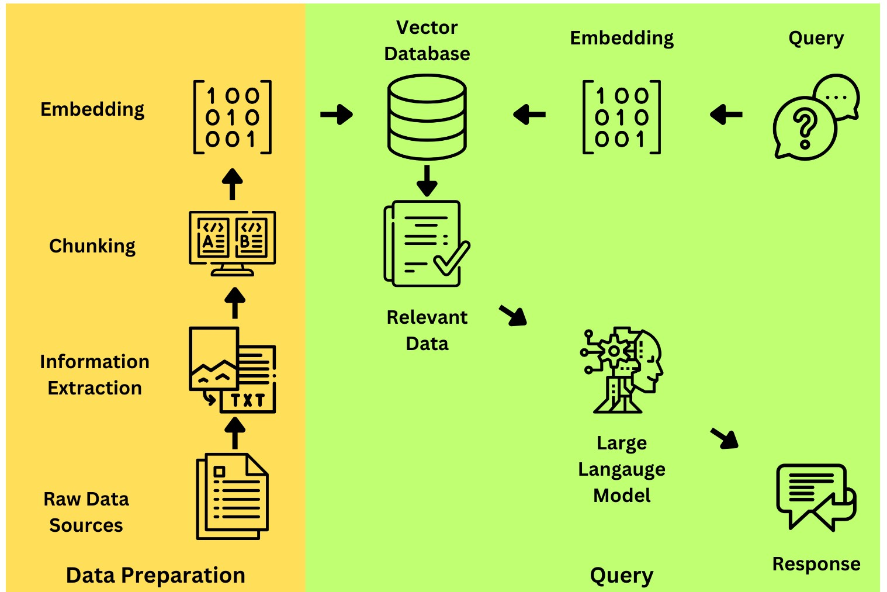
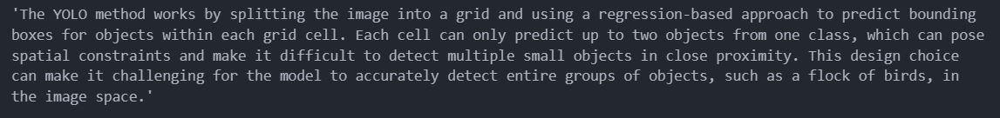

<p align="center">
  
  <br />
  <em>Figure 1: AI Generated Image with the prompt "An AI Librarian retrieving relevant information"</em>
</p>


## Introduction

Retrieval-Augmented Generation (RAG) grounds an LLM's answers in documents it was not trained on, by retrieving relevant passages at query time and including them in the prompt. It is a common pattern when an LLM system must answer questions over a large body of private or specialised text. In this post, I implement RAG with LangChain, a framework for building applications around LLMs, using Chroma as the vector database. We will set up the environment, prepare the data, build the vector database and query it.

<p align="center">
  
  <br />
  <em>Figure 2: Retrieval Augmented Generation (RAG): overview</em>
</p>

Figure 2 shows an overview of RAG. The first step is data preparation (highlighted in yellow) in which you must:
1) Collect raw data sources.

2) Extract the raw text (using OCR, PDF parsers, web crawlers etc.).

3) Split the text into appropriate length chunks.

4) Compute an embedding for each chunk and store it in the vector database.


Once the vector database has been created, you can query the system (highlighted in green):
1) A user can query the system with raw text.

2) An embedding is computed for the query.

3) Search the vector database for the chunks most similar to the query.

4) Give the retrieved context and the query to an LLM.

5) Return the grounded response to the user.


### Understanding RAG and LangChain

RAG combines a retriever with a generative model: the retriever finds relevant text, and the LLM uses it to answer. LangChain provides building blocks (document loaders, text splitters, embedding wrappers, vector store integrations and LLM clients) that make this quick to prototype; LlamaIndex is a popular alternative.

There are many ways to build an effective RAG system, and finding the best one requires experimenting with each component: data collection, embedding model, chunking method and prompt template. Most systems follow the same design, which I walk through below.

## Setting up the Environment

Create a virtual environment and install the dependencies (the [repo](https://github.com/CallumJMac/lessons/blob/main/1.%20RAG/rag.ipynb) contains the code for this post):

```bash
python3 -m venv .venv
source .venv/bin/activate  # On Windows: .venv\Scripts\activate
pip install -r requirements.txt
```

You will also need an OpenAI API key in a `.env` file (`OPENAI_API_KEY=...`), which `load_dotenv()` reads below.

## Implementation: Step-by-Step

### 1: Import Dependencies

```python
# Langchain dependencies
from langchain.document_loaders.pdf import PyPDFDirectoryLoader  # Importing PDF loader from Langchain
from langchain.text_splitter import RecursiveCharacterTextSplitter  # Importing text splitter from Langchain
from langchain.embeddings import OpenAIEmbeddings  # Importing OpenAI embeddings from Langchain
from langchain.schema import Document  # Importing Document schema from Langchain
from langchain.vectorstores.chroma import Chroma  # Importing Chroma vector store from Langchain
from dotenv import load_dotenv # Importing dotenv to get API key from .env file
from langchain.chat_models import ChatOpenAI # Import OpenAI LLM
from langchain.prompts import ChatPromptTemplate # Import prompt template


import os  # Importing os module for operating system functionalities
import shutil  # Importing shutil module for high-level file operations
```

### 2: Loading in the Data

For further information on how to load data from other types of files see the [LangChain docs](https://docs.langchain.com/oss/python/integrations/document_loaders). There are loaders for `.csv`, `.html`, `.json` and many more.

```python
# Directory to your pdf files:
DATA_PATH = "/data/"

def load_documents():
    """
    Load PDF documents from the specified directory using PyPDFDirectoryLoader.

    Returns:
        List of Document objects: Loaded PDF documents represented as Langchain Document objects.
    """
    document_loader = PyPDFDirectoryLoader(DATA_PATH)  # Initialize PDF loader with specified directory
    return document_loader.load()  # Load PDF documents and return them as a list of Document objects

documents = load_documents() # Call the function
# Inspect the contents of the first document as well as metadata
print(documents[0]) 
```

### 3: Chunking

In RAG systems, "chunking" means splitting the text into shorter units that are each embedded and retrieved independently. This lets the system pinpoint the relevant passages rather than whole documents. Chunk quality is **essential** to how well your system performs.

The most important consideration is the structure of your documents. For example, if they consist of similar-length paragraphs, sizing chunks around a paragraph keeps each chunk on a single topic. `RecursiveCharacterTextSplitter` helps here: it tries to split on paragraph breaks first, then lines, then spaces, so chunks tend to end at natural boundaries.

```python
def split_text(documents: list[Document]):
    """
    Split the text content of the given list of Document objects into smaller chunks.

    Args:
        documents (list[Document]): List of Document objects containing text content to split.

    Returns:
        list[Document]: List of Document objects representing the split text chunks.
    """
    # Initialize text splitter with specified parameters
    text_splitter = RecursiveCharacterTextSplitter(
        chunk_size=300,  # Size of each chunk in characters
        chunk_overlap=100,  # Overlap between consecutive chunks
        length_function=len,  # Function to compute the length of the text
        add_start_index=True,  # Flag to add start index to each chunk
    )
    # Split documents into smaller chunks using text splitter
    chunks = text_splitter.split_documents(documents)
    print(f"Split {len(documents)} documents into {len(chunks)} chunks.")

    # Print example of page content and metadata for a chunk
    document = chunks[0]
    print(document.page_content)
    print(document.metadata)

    return chunks  # Return the list of split text chunks
```

Because `length_function=len`, `chunk_size` is measured in characters, not tokens (300 characters is roughly 50 to 75 English words). If chunks are too large, a single embedding has to summarise several topics, which blurs retrieval, and you pass more irrelevant text to the LLM; you can also fit fewer chunks into the context window. If chunks are too small, each one may lack the context needed to be understood or to answer the question.

`chunk_overlap` is the maximum number of characters shared between consecutive chunks (here up to 100). Overlap reduces the chance that a sentence or idea is cut in half at a chunk boundary, at the cost of some duplicated storage and retrieved text.

For real applications, plot the distribution of text lengths in your data and tune `chunk_size` and `chunk_overlap` experimentally.


### 4: Creating a Vector Database with Chroma

To turn your text into embeddings, you need an *embedding model*: a pre-trained model that maps a piece of text to a fixed-length vector. The model is trained so that texts with similar meaning end up close together in this high-dimensional space. Individual dimensions are not interpretable on their own; meaning is captured by the vector as a whole, which is why we compare vectors with measures such as cosine similarity.

The choice of the embedding model used impacts the overall efficacy of the system, however, [some engineers](https://gradientflow.substack.com/p/best-practices-in-retrieval-augmented) note that the choice of embedding model often has less of an impact than the choice of chunking strategy. The same article notes that the largest, top-ranked embedding models are not always best: smaller models can outperform them on specific tasks, so you may be able to cut cost without losing effectiveness.

I use Chroma because it is designed for this use case, but extensions such as [pgvector](https://github.com/pgvector/pgvector) let you store and search vectors in PostgreSQL. I use the OpenAI embeddings API, which requires an API key:

```python
# Path to the directory to save Chroma database
CHROMA_PATH = "chroma"  

def save_to_chroma(chunks: list[Document]):
    """
    Save the given list of Document objects to a Chroma database.

    Args:
        chunks (list[Document]): List of Document objects representing text chunks to save.

    Returns:
        None
    """
    # Clear out the existing database directory if it exists
    if os.path.exists(CHROMA_PATH):
        shutil.rmtree(CHROMA_PATH)

    # Create a new Chroma database from the documents using OpenAI embeddings
    db = Chroma.from_documents(
        chunks,
        OpenAIEmbeddings(),
        persist_directory=CHROMA_PATH
    )

    # Persist the database to disk
    db.persist()
    print(f"Saved {len(chunks)} chunks to {CHROMA_PATH}.")
```

I encourage experimenting with open embedding models, especially if your system needs to run fully locally. Sentence Transformers models (such as `all-MiniLM-L6-v2`) and families such as BGE, E5 and Nomic Embed can be used through LangChain's Hugging Face or Ollama embedding integrations, and the [MTEB leaderboard](https://huggingface.co/spaces/mteb/leaderboard) is a useful starting point for comparing them. Note that a generative LLM such as Llama 3 is not a drop-in embedding model; use a model trained for embeddings. Whichever model you choose, you must use the same one to embed both the documents and the queries. For very niche domains, off-the-shelf embedding models may retrieve poorly, and fine-tuning the embedding model on domain data can improve retrieval quality.


```python
def generate_data_store():
    """
    Function to generate vector database in chroma from documents.
    """
    documents = load_documents()  # Load documents from a source
    chunks = split_text(documents)  # Split documents into manageable chunks
    save_to_chroma(chunks)  # Save the processed data to a data store

# Load environment variables from a .env file
load_dotenv()
# Generate the data store
generate_data_store()
```


### 5: Query the vector database and the LLM

First, we need a question to answer from our PDF. The PDF in this example is my MSc thesis on using computer vision to track hand movements automatically to diagnose Parkinson's disease. I used an object detector, YOLOv4, to predict a bounding box around the hand and crop away unnecessary pixels, so let's ask the system to explain how YOLO works:

```python
query_text = "Explain how the YOLO method works"
```

Next, we define the prompt template for the LLM that generates the final response. The structure of `PROMPT_TEMPLATE` below is simple: `{context}` is filled with the chunks **retrieved** from our Chroma database, the prompt is **augmented** with that context alongside the user's `{question}`, and the LLM uses both to **generate** a grounded response.

```python
PROMPT_TEMPLATE = """
Answer the question based only on the following context:

{context}

---

Answer the question based on the above context: {question}
"""
```

We have defined our query and prompt template. Let's put it all together!

When tuning retrieval, you want to find the most relevant information, quickly. The main retrieval approaches are:

1) **Term-based (lexical) search**: scores chunks by overlapping terms, weighted by term statistics (for example BM25, which uses term frequency and inverse document frequency). It needs no embedding model and excels at exact matches such as names, acronyms and identifiers, but misses paraphrases and synonyms.

2) **Vector-similarity search**: embeds the query and finds the nearest chunk embeddings by a similarity or distance measure (such as cosine similarity), usually with an approximate nearest neighbour index. It captures semantic similarity even when wording differs, but can miss rare exact terms.

3) **Hybrid search**: combines lexical and vector results, for example by fusing their rankings with reciprocal rank fusion, to get the strengths of both.

In this example, we use vector-similarity search, retrieving the top `k=3` chunks. The best method and parameters should be found experimentally for your domain. Other parameters to tune include:
- `k`, the number of chunks retrieved
- the relevance score threshold (we set ours to 0.7 arbitrarily)
- the LLM (base vs. fine-tuned)
- the prompt template

`similarity_search_with_relevance_scores` converts Chroma's vector distance into a relevance score intended to lie between 0 and 1, where higher means more similar. The 0.7 check in the code only looks at the best match: if even the top chunk scores below it, we treat the question as unanswerable from our data. The score is not a probability that a chunk is relevant, and its typical range depends on the embedding model and distance metric, so calibrate the threshold on your own queries rather than reusing 0.7.

```python
def query_rag(query_text):
    """
    Query a Retrieval-Augmented Generation (RAG) system using Chroma database and OpenAI.

    Args:
    - query_text (str): The text to query the RAG system with.

    Returns:
    - formatted_response (str): Formatted response including the generated text and sources.
    - response_text (str): The generated response text.
    """
    # YOU MUST - Use same embedding function as before
    embedding_function = OpenAIEmbeddings()
    
    # Prepare the database
    db = Chroma(persist_directory=CHROMA_PATH, embedding_function=embedding_function)

    # Retrieving the context from the DB using similarity search
    results = db.similarity_search_with_relevance_scores(query_text, k=3)
    
    # Check if there are any matching results or if the relevance score is too low
    if len(results) == 0 or results[0][1] < 0.7:
        print("Unable to find matching results.")
        return None, None

    # Combine context from matching documents
    context_text = "\n\n---\n\n".join([doc.page_content for doc, _score in results])
    
    # Create prompt template using context and query text
    prompt_template = ChatPromptTemplate.from_template(PROMPT_TEMPLATE)
    prompt = prompt_template.format(context=context_text, question=query_text)

    # Initialize OpenAI chat model
    model = ChatOpenAI()
    
    # Generate response text based on the prompt
    response_text = model.predict(prompt)

    # Get sources of the matching documents
    sources = [doc.metadata.get("source", None) for doc, _score in results]
    
    # Format and return response including generated text and sources
    formatted_response = f"Response: {response_text}\nSources: {sources}"
    return formatted_response, response_text

# Let's call our function we have defined
formatted_response, response_text = query_rag(query_text)

# and finally, inspect our final response!
print(response_text)
```
<p align="center">
  
  <br />
  <em>Figure 3: RAG System output to query: "Explain how the YOLO method works"</em>
</p>

The response in Figure 3 describes YOLO using information retrieved from my thesis. The prototype works on this example, but it leaves several questions:
- How well does the system work in general?
- How do we quantify how much better the RAG-enabled LLM is than the LLM alone?
- When tuning the RAG parameters (such as chunking method, prompt template or LLM), how do we know whether a change improved or worsened the responses?

### 6: Evaluation

The prototype uses arbitrary values. The next step is finding the best combination of chunking logic, embedding model and LLM, which requires a way to measure quality. Generative outputs are hard to evaluate quantitatively, so here I sketch an approach to develop in a future post.

Because the system has several interchangeable stages, evaluate each component in isolation as well as end to end:
- **Component-wise evaluation**: for example, compare embedding models and retrieval methods using standard retrieval metrics (such as recall@k or mean reciprocal rank) on questions with known relevant chunks, and compare LLMs and prompts given fixed context.
- **End-to-end evaluation**: assess the quality of the entire system.

I also recommend writing tests that ask an LLM to judge whether the RAG system's actual response matches an expected response. For example, using the following evaluation prompt, logic and test pseudocode:

```python
# Template for evaluation prompt
EVAL_PROMPT = """
Expected Response: {}
Actual Response: {}
###
(Answer with 'True' or 'False': Does the actual response match the expected response?)
"""

def query_and_validate(prompt: str, expected_response: str) -> bool:
    _, actual_response = query_rag(prompt)
    eval_prompt = EVAL_PROMPT.format(expected_response, actual_response)
    evaluation_results_str = ChatOpenAI().predict(eval_prompt)

    # Strip leading/trailing whitespace and convert to lowercase
    retrieval_test_response = evaluation_results_str.strip().lower()

    # Check if "true" or "false" is present in the response
    if "true" in retrieval_test_response:
        return True
    elif "false" in retrieval_test_response:
        return False
    else:
        # Raise an error if neither "true" nor "false" is found
        raise ValueError("Did not return true or false")

def test_retrieval_response():
    # Test function to validate retrieval response
    assert query_and_validate(
        prompt="a question about our data",
        expected_response="a known fact in our data"
    )
```

This needs formalising, but it is a good starting point for testing RAG systems.

A lenient LLM judge might pass incorrect responses, so also add negative test cases: supply a deliberately wrong expected response and assert that the judge returns `False`.

## Conclusion

In this post, I introduced Retrieval-Augmented Generation and showed how to query a PDF using LangChain and Chroma in Python. I also outlined how to tune a RAG system and evaluate its responses quantitatively with component-wise metrics and LLM-judged tests.

### Links
[Github repo](https://github.com/CallumJMac/lessons/blob/main/1.%20RAG/rag.ipynb) for this blog.

Original [RAG paper](https://arxiv.org/abs/2005.11401) (Lewis et al., 2020).

Connect with me on [LinkedIn](https://www.linkedin.com/in/callumjmac/) for enquiries.
